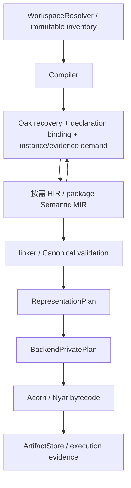

# 架构详解

Valkyrie 的语言可观察语义以 valkyrie-2020 为权威。本文规定事实所有权与接口，不以设计图宣称实现完成。

## 编译边界

这是事实流，不把所有 target 合成一份最终物理 IR。不同 target 的表示、ABI 和编码可以不同，但不得改变共同语言语义。

## 事实所有者

Oak 拥有 token/CST/AST、语法形态、恢复与语法诊断。Valkyrie frontend 拥有名称、类型、place、泛型替换、trait/imply evidence、调用与语义需求；Nyar 拥有通用 IR/验证、优化、表示与降低框架；Acorn 拥有外部二进制格式。

Legion 仅组织 manifests/package graph、不可变输入、Compiler、cache 和 ArtifactStore，不直接访问语义 planner、AST/HIR/MIR。core/std 提供语言基础和统一库行为，adaptor 提供目标实现，由 linker 显式选择。

源码 formatter 归 Oak lossless CST/token-gap，PP document 归模型文本输出；CLI/LSP 可以适配接口，不能因此取得排版或语义所有权。

## 绑定与需求固定点

inventory 不是 body 编译集合。索引、可见绑定、类型推断及实例/evidence 需求协作到固定点，只物化被需求 body。每个节点都有从 entry export 到声明、实例、witness 的合法依赖链。

短名唯一不证明可见；同名成员不证明属于当前 owner；同声明不同泛型实例不相同。签名、字段、Cast、别名与关联类型等全部类型位共享绑定。不能用文件、选择名或全库 lowering 替代实例需求。

## 调用与结构操作

AST unary/binary grammar 在 HIR 展开为普通 callable；用户函数、std、trait/imply 和 operator 语法共用解析。调用经声明、substitution/evidence、ItemInstanceId 与完整签名冻结，Semantic MIR 为 Invoke(callee, arguments)。

nominal ADT、fixed array、tuple 允许有限且类型参数化的结构操作；不按元素类型、arity 或 target 扩 opcode。后端数值指令来自已绑定实现，不能按 callable 拼写决定语义。

## 链接、表示与编码

linker 冻结 adaptor/import 与跨包实例。Canonical 验证调用、完整类型、field/variant owner 和 SSA。优化保持已定语义；RepresentationPlan 是 stable semantic ID keyed 的稀疏布局侧表，不复制 CFG、不选 adaptor。

backend 只编码通过 pre-encode validation 的 BackendPrivatePlan。布局、ABI、import signature、carrier、payload 缺失必须结构化失败，不能默认、猜名字或回调 frontend 修补。

## 恢复与证据

Oak 保留可用树、missing/error 与 diagnostics；恢复不能伪造正常程序。frontend 检查语言语义，Compiler 按可达性决定准入；lint 不另设 build 门禁。各阶段保留 stage/code/owner/source/span。

分别记录机制删除、合同成立和真实交付。正反性质覆盖可达/不可达、同文件 body、同名 owner/namespace、未声明依赖和跨包实例/evidence。当前交付以全部理想 solution.v 的 nyar/wasm 真实 artifact/export/invoke 和 metadata.tests 为准，其他 target 与自举不替代。

## 相关文档

- [依赖规则](dependency-rules.md)
- [编译阶段合同](../maintainer/compilation.md)
- [目标家族契约](../maintainer/target-family-contract.md)
- [公共图形栈](graphics-stack.md)
