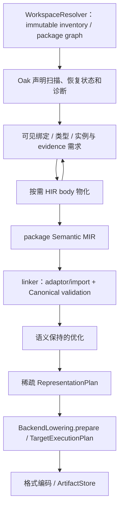

# 编译管线与阶段合同

本文固定输入、事实所有者和拒绝边界。设计合同不表示功能已经完成。

## 编译流

声明索引、绑定和实例需求协作到固定点。不是先完成全部函数体再裁剪，也不要求未物化 body 已完成语义分析。

## 输入与需求

inventory 记录 manifest 声明的来源；声明索引提取签名、导出、类型及可见性；需求图决定哪些 body 与实例进入 HIR。每个物化节点都须有入口需求边。

无计划、显式空需求和非空需求未物化是不同状态。读取/解码、声明索引和 body 诊断分别规定阻断范围。不可达坏 body 不阻断入口，可达坏 body 不能进入成功 MIR。

## 语法、恢复与语义

Oak 输出树、recovery/missing/error 与 diagnostics。namespace 语法形态显式保留，缺 token 不补成普通运算符或空名称；保留后续有效声明。语法恢复不等于语义准入。

Valkyrie frontend 负责名称、类型、place、definite assignment、泛型替换与 evidence。所有类型位共用绑定，包括签名、字段、Cast 与关联类型。短名唯一不能替代依赖可见性。

AST unary/binary 语法在 HIR 展开为普通 callable；所有调用经完整实例与签名进入 Invoke。MIR 不按 callee 拼写补类型或行为。

## 链接、表示与编码

linker 冻结跨包身份、adaptor 与 import signature。Canonical validation 验证完整实例、字段/变体 owner、调用与 SSA 事实。优化只能保留已定语义。

RepresentationPlan 以 stable semantic ID 记录稀疏 carrier/layout，不复制 CFG 或选择 adaptor。BackendLowering.prepare 生产目标私有计划；所有编码入口预先验证。backend 只编码 TargetExecutionPlan，不查名称补 ABI、layout 或载荷。

Acorn 编码外部格式；nyar-bytecode 编码 Nyar 自有字节码。ArtifactStore 原子提交完整 artifact 与 evidence。

## 诊断、工具与缓存

各域保留 stage/code/owner/source/span，Compiler 汇总诊断。Lint 不另设编译门禁；formatter 属于 Oak CST/token-gap，pretty printer 只输出模型文本。

inventory provenance 与语义 freshness 分开；语义摘要覆盖实际影响编译的声明、签名、body、可见绑定环境与 Compiler/host。target/profile、adaptor 选择和 artifact 摘要在对应阶段绑定。缓存读取前重算期望身份，不兼容读取缺字段旧证据。

## 验收

每项工作包先定义行为、缺事实、唯一生产者、接口和失败方式。正反验证覆盖不可达/可达坏 body、同文件 body 隔离、同名不同 owner/namespace、未声明依赖、跨包实例/evidence。

分别报告机制删除、合同性质和真实交付；每个工作包及时回到正式两 target 路径。单个错误消失不代表根合同成立，局部 fixture 不能代替真实 artifact/export/invoke 和 metadata.tests。
