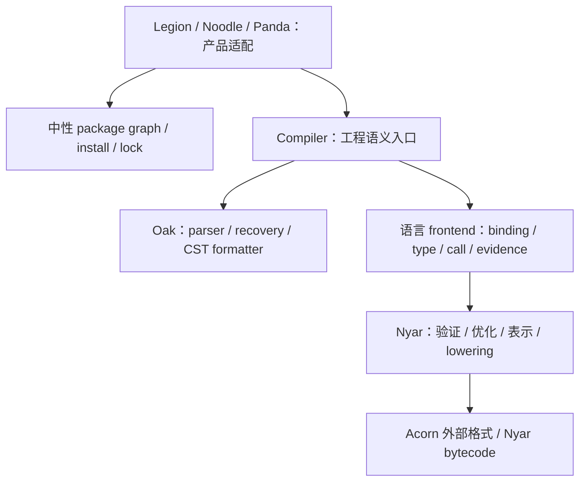

# 工具链架构边界

产品 CLI 适配生态清单、路径与用户选项；核心 module 的事实由各自所有者生产，产品调用入口不能改变所有权。

## 所有者

Legion 外部深模块只有 WorkspaceResolver、Compiler、ArtifactStore。源码 inventory/package graph 进入 Compiler；语义闭包、HIR/MIR 和 backend plan 是内部事实，不由产品 CLI 构造。

## 质量工具

fmt 由对应 Oak lossless CST/token-gap formatter 生成 edits。产品只适配路径、配置和写入；不另建格式规则，不以 PP 文本打印兜底。

check/LSP 语义分析共享工程依赖快照；frontend 决定语义合法性。Lint 提出维护建议，不按行数或文本子串阻断 build，不孤立编译单文件制造第二套工程真相。

PP document 用于 AST/IR/值模型到文本，不构成源码 formatter 能力。

## 包管理与脚本

nyar-package-manager 保持产品中立，产品注入 manifest/layout/registry 参数。依赖来源由显式清单和锁定身份决定，不由 lockfile 嗅探或失败后静默更换。

ScriptRunner 可以执行用户声明的脚本；这不授权产品把语义编译委托外部工具或调用宿主补缺失事实。

## 验收

依赖图与生产调用链共同证明所有权；名称扫描只作辅助。删除错误路线须迁移消费者、移除实现与依赖并证明旧入口不可达。wrapper、单个命令或局部测试成功均不能证明完整源码编译与真实交付。

- [Legion](legion.md)
- [Noodle](noodle.md)
- [Panda](panda.md)
- [架构详解](../developer/architecture.md)
